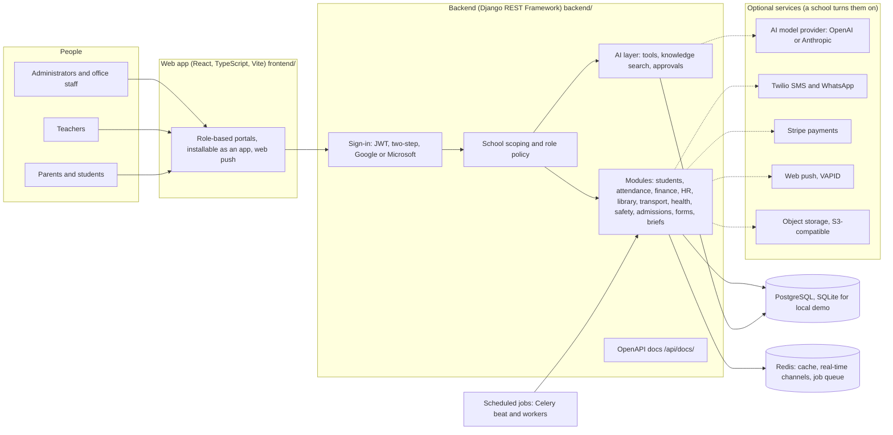
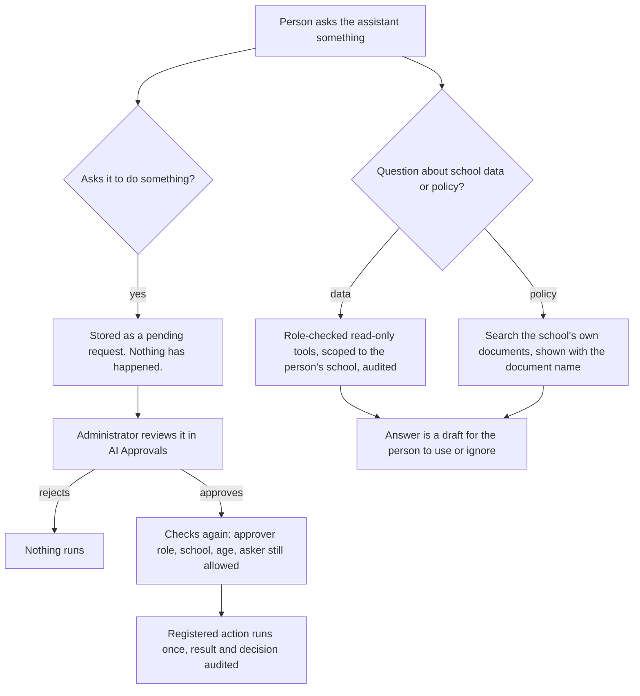
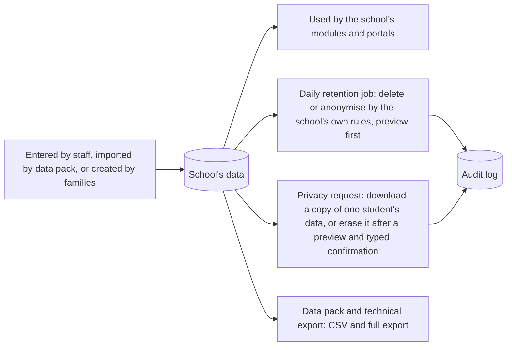

# CC-EMS architecture

Diagrams are written in Mermaid, which GitHub and most Markdown viewers draw as pictures. They show how the system is put together today;
file paths are given so each box can be found in the code. For privacy and testing detail see [CLIENT_READINESS.md](CLIENT_READINESS.md) and
[TENANT_ISOLATION_TEST_SUMMARY.md](TENANT_ISOLATION_TEST_SUMMARY.md).

## 1. The system



In the hosted demo the web app runs on Vercel and the backend on Render. The free demo plan has no job worker, so scheduled jobs (daily briefs,
retention, library reminders) are run by hand or by a cron there.

## 2. How one request stays inside one school

```mermaid
sequenceDiagram
  participant B as Browser
  participant J as TenantJWTAuthentication
  participant V as View (DRF)
  participant M as Model manager
  participant D as Database
  B->>J: request with the signed-in person's token
  J->>J: find the person's school (never taken from the request body)
  J->>V: school set for this request
  V->>M: read rows
  M->>D: query filtered to that school (registry.py)
  D-->>V: only that school's rows
  V->>M: save a new row
  M->>M: stamp the school; refuse a row that names another school
  Note over J,M: A person with no school gets no school data at all. A test fails if a model with a school link is neither in the registry nor on the reviewed list.
```

## 3. How the AI assistant acts: it can only ask



AI risk scores follow the same rule: they are labelled advice, and each high flag waits for a person's recorded decision.

## 4. Data lifecycle



## 5. Repository map

| Folder | What is in it |
|---|---|
| `frontend/src/pages`, `components`, `services` | Screens, shared parts and API calls |
| `backend/services/core` | Accounts, school scoping, security, privacy, billing, audit, notifications, backups |
| `backend/services/education` | School modules (students, attendance, finance, HR, library, transport, and so on) |
| `backend/services/ai` | AI assistant, tools, document search, approvals |
| `backend/services/analytics`, `ai-ml/` | Risk scoring and prediction models |
| `backend/tests` | Automated tests (including the school isolation tests) |
| `docs/` | This and the other guides |
| `deploy/` | Hosting notes for the hosted demo |
